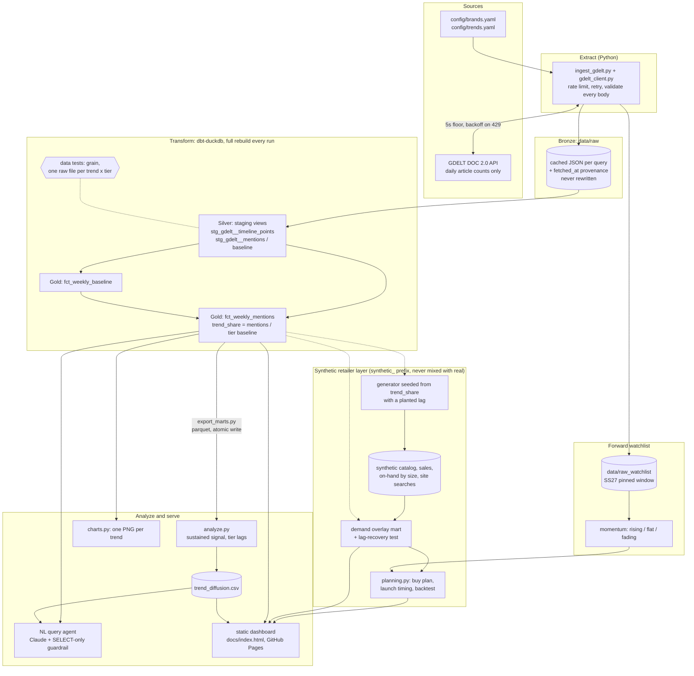

# Trickle-Down Trend Tracker

**Can news coverage tell a fashion brand what to stock, and when?**

**[Open the interactive dashboard →](https://snehamondal-data.github.io/fashion-trend-engine/)**

**The problem.** A clothing brand decides what to make, and how much, months before anyone buys it.
Guess wrong and it's left with racks of unsold stock, or sold-out bestsellers it can't restock in
time.

**The question.** Fashion's old rule is "trickle-down": a trend appears on luxury runways (the
Fall/Winter 2026 shows, Feb–Mar 2026), semi-luxury brands adapt it, then high-street brands
mass-produce it. If that order is reliable and the timing predictable, a brand can see demand
coming. Is it? And can press buzz work as an early warning?

**How it's measured.** Weekly news coverage of 14 FW26 trends across four brand tiers, from GDELT
article *counts* (no article text). Each trend is measured as a share of that tier's own coverage,
because luxury brands get far more press regardless of trend. The **lag** is the number of weeks
between one tier's press first breaking out on a trend and the next tier's.

**The answer so far.**
- **Not a neat ladder.** Semi-luxury press broke out *before* luxury for 6 of 9 trends, and
  high-street brands led as often as they followed (6–6). Details in [Findings](#findings).
- **The clearest signal isn't a trickle at all.** Suede sits in a typical 13% of mid-market shoe and
  bag coverage every week, against about 2% elsewhere. It never "breaks out", so a breakout detector
  misses it.
- **The method holds up when the answer is known.** On a simulated store, Sage & Blush, whose
  shoppers were built to want a trend exactly 6 weeks after semi-luxury press covers it, the
  analysis found the hidden 6 weeks for all 14 products without being told. It also passes
  harder versions of that test (below).
- **It's built to look forward.** A watchlist of 8 sourced spring/summer 2027 runway trends fills
  in as the post-show press data arrives. An "in season now" view flags which fall trends' press
  is rising and when demand would follow. Both show **"Incomplete data"** rather than a number
  wherever GDELT's own coverage has gaps. Right now that's every reading: whole days in
  mid-September and early October 2026 are missing from GDELT.

## How a brand would use this

Three steps, each built here. Step 1 runs on real press. Step 2 runs on the simulated store,
because no real retailer's data is available. Step 3 uses real press with a delay measured on the
simulated store. `src/planning.py`, `make planning`.

**1. Early warning, about six months ahead.** Right after the runway shows, check which trends'
press is gaining. *Momentum* compares a trend's share of a tier's coverage in the show weeks plus
two against the eight weeks before. At 1.5× or more it's **rising**, at ⅔ or less **fading**,
otherwise **flat**, with fewer than 10 mentions **too little press** to say. This is press
momentum, not a sales forecast. The **SS27 watchlist** runs it on 8 spring/summer 2027 trends in
`config/trends.yaml` (`season: SS27`): satin, statement belts, yellow, green, metallics, double
denim, skirts and bra tops. Each was taken from runway reporting that names the houses that
showed it, with the source linked. Candidates without named houses in a readable source were left
out rather than guessed. The shows came after the main 12-month fetch ended, so the watchlist has
its own pinned-date fetch (`make ingest-watchlist`) → `data/output/planning/watchlist_SS27.csv`
and the dashboard. The main pipeline still loads only the FW26 trends. If any week in either window has less
than half the tier's typical coverage, the reading is **incomplete data**, not a momentum figure.
GDELT lost whole days in Sep–Oct 2026: semi-luxury brand coverage fell from ~220 articles a week
to 0–11 in some weeks. Without this rule, a trend with 0 mentions in a gap week read as "fading
×0.0".

**2. Buy plan.** Start from last season's sales per product. Tilt the buy by the trend signal:
multiplier = √momentum, capped at **+50% / −25%**. Flat or thin press leaves the buy where history
puts it. The square root and the caps are deliberate: one season's press shouldn't be able to
double an order.

**3. Launch timing, weeks ahead: "in season now".** Shoppers follow press with a delay, and the
delay comes from what the lag analysis *measured* for each product, never a fixed number. The
in-season view compares the last four weeks of real semi-luxury press against the eight before.
For each fall trend that's rising, it shows when demand would land: the same weeks, shifted by
that product's delay. Marketing starts two weeks before; stock lands one week before. The delay
was measured on the simulated store, and it's labelled that way. A real store would use the delay
from its own searches. Products whose delay didn't beat chance get no dates. A press-to-demand
delay is weeks, not months, so this step is for timing campaigns and allocating stock already
bought. The six-month buy is step 2's job. → `data/output/planning/in_season_now.csv`.

**Does the signal actually help? Backtest on a simulated season** (Sage & Blush, FW26). Decide on
20 Apr 2026 using only press seen by then, sell for 22 weeks against the store's true demand, and
compare one up-front buy with and without the trend signal:

| | Without signal | With signal |
|---|---|---|
| Buys changed | — | 4 of 14 |
| Units off true demand | 1,957 | **1,688** (−14%) |
| Units left over | 1,630 | **1,361** (−17%) |
| Product-weeks sold out | 13 | 13 |

Read honestly:
- The gain is real but narrow. It all came from cutting buys on fading trends (oxblood, plaid,
  brooches).
- The one rising trend (purple) was over-bought: 793 units against a true demand of 578.
- The signal didn't prevent a single sold-out week. The worst miss was skirt suits (8 weeks sold
  out), where press was too thin for the signal to act on.
- The simulated store's demand is built from press, so this checks that the plumbing works and
  that the signal's direction is sensible. It is not evidence that press predicts a real store's
  demand. That takes the store's own data.

## Architecture



Everything in the diagram runs today. Dashed arrows mark where real press feeds the simulated store.

Medallion layers, kept structurally separate:
- **Bronze** (`data/raw/`) — exactly what GDELT returned, wrapped with fetch provenance. Append-only;
  a cache file is never rewritten in place.
- **Silver** (dbt staging views → `data/staging/`) — typed, normalized rows: one per
  `(trend_id | tier, date)`. The raw JSON schema is declared, not inferred.
- **Gold** (dbt mart tables → `data/marts/`) — weekly aggregates joined into `trend_share` (see
  below); `analyze.py` builds lags and classifications on top.
- **Synthetic** — the fictional retailer's simulated sales, stock and searches live in their own
  `synthetic` dbt schema and `data/synthetic/`, so they can never be joined to real data by accident.
  Planning outputs built from them are prefixed `simulated_`.

The transform runs in dbt (`make transform-dbt`); `tests/test_dbt_parity.py` asserts it produces
output identical to the original Python `transform.py`, which is kept for now. Both fully
recompute staging and both marts from whatever is currently in `data/raw/` on every run, and
write atomically (temp file + rename). Nothing is ever appended to an existing
output, so a rerun cannot create duplicates — that guarantee holds by construction, not by a
dedup step.

## Data sources & legal notes

The only external data source is the [GDELT DOC 2.0 API](https://blog.gdeltproject.org/gdelt-doc-2-0-api-debuts/),
specifically `mode=timelinevolraw`: **daily article counts** matching a boolean keyword query,
plus `norm` (total articles GDELT monitored that day, for normalization). This endpoint returns
**counts only** — no headlines, no URLs, no article text. This project never calls GDELT's
article-list endpoint, so no copyrighted article content is ever fetched or stored; `data/raw/`
contains nothing beyond aggregate mention counts and the query that produced them.

Two things learned by hitting the live API directly (not documented in GDELT's own docs):

1. **`Parentheses may only be used around OR'd statements.`** A single search term must be bare;
   only a group of 2+ terms joined by `OR` may be wrapped in `()`.
2. **A bare term with a "special" character is rejected as an "illegal character."** A bare
   `H&M` failed; GDELT's own error message says to quote it instead (its example is a dash,
   `"f-16"`). `query_builder.py` quotes any term that isn't plain alphanumeric, not just
   multi-word phrases.
3. **Rate limit, stated by the API itself:** *"Please limit requests to one every 5 seconds."*
   This came back as plain text, sometimes under HTTP 429, sometimes under HTTP 200 — so the
   client never trusts status codes alone; every response body is parsed and schema-validated
   regardless of status. In practice, under sustained use, the *effective* throttling was
   noticeably stricter than that stated floor — individual requests sometimes needed several
   minutes of retrying, and the pipeline hit what looked like an extended soft-block on one IP
   during heavy testing (a different network cleared it immediately). `ingest_gdelt.py` is
   written assuming this will happen again: it fails fast per-request (`MAX_RETRIES=3`, capped
   backoff) rather than retrying forever, stops the whole run after
   `MAX_CONSECUTIVE_TASK_FAILURES` (default 3) failures in a row, and is fully resumable — the
   raw cache is durable, so a rerun only fetches what's still missing and reports a cached/
   fetched/failed summary at the end.

## Design decisions & trade-offs

**Normalize by tier baseline, not raw counts.** Luxury houses (Chanel, Hermès) get structurally
more press than affordable brands (Mango, Uniqlo) regardless of any specific trend — so raw
mention counts would make luxury look like the first mover for *every* trend, by construction.
Three baseline queries (brands OR'd, no trend terms) are fetched per tier, and every trend's
weekly mentions are expressed as `trend_share = trend_mentions / tier_baseline_mentions`. All
signal detection, lag calculation, and charts run on `trend_share`; raw `mention_count` stays in
`weekly_mentions.parquet` for reference.

**Sustained signal, not a fixed volume threshold.** A single viral article shouldn't be able to
mark a trend as "emerged." Per `(trend, tier)`, a week counts as `elevated` only if its 3-week
rolling mean share exceeds the trailing 8-week median share by 2x (`SIGNAL_FACTOR`, in
`src/config.py`), and `first_signal_week` requires 2 consecutive (`SUSTAINED_WEEKS`) elevated
weeks. One caveat this produces: if an elevated period runs long enough (several weeks), the
trailing median itself eventually rises to include those elevated weeks, and the plateau can stop
being flagged as "elevated" even though coverage hasn't dropped — the algorithm is tuned to catch
the *onset* of a breakout, not to track every week of a long-sustained trend. `peak_week` is
therefore the max-share week among weeks the algorithm *did* flag as elevated (ties broken by the
earliest such week), which can under-represent a true peak that arrives late in a long plateau.

**Ambiguous brand names get a disambiguating `search_term`.** "Theory", "Reformation", "COS", and
"Mango" are common words/acronyms that would pull in unrelated news under a bare-name query.
`config/brands.yaml` lets a brand entry be `{name, search_term}` instead of a plain string (e.g.
`Theory` → `"Theory clothing"`); `search_term` defaults to `name` when not given. This is a
precision-over-recall call: some true-positive mentions that don't happen to include the
disambiguating word are lost, in exchange for far less noise. **"The Row" stays unresolved** — no
good disambiguating term exists for it without meaningfully hurting recall, so it's a known,
documented source of noise in the luxury baseline and any trend involving that brand.

**Full-recompute idempotency over incremental upsert.** `transform.py` always rebuilds staging
and both marts from the entire `data/raw/` directory rather than merging new rows into existing
parquet files. Simpler than upsert/merge logic, and correct at this data scale (14 trends × 4
tiers + 4 baselines = 60 raw files).

**Provenance on every row.** Each raw cache file wraps the GDELT response with `query`,
`timespan`, `url`, and `fetched_at` (UTC). `fetched_at` is written once, at actual fetch time, and
carried through unchanged as `ingested_at` on every staging row sourced from that file —
`transform.py` never stamps `datetime.now()` itself, since doing so would make two runs over
identical raw inputs produce different output and break the idempotency guarantee.

## Limitations

- **Fashion-week weeks inflate luxury coverage regardless of trend.** Feb–Mar 2026 (the FW26 show
  season) is a spike in luxury press volume across the board — including for brands/trends that
  have nothing to do with a given query. Baseline normalization (`trend_share`) mitigates this
  (a trend's share of *that week's* elevated luxury coverage, not raw counts), but doesn't
  eliminate it entirely; charts shade the FW26 show window for this reason.
- **News volume measures press attention, not product adoption.** A trend "reaching" the
  affordable tier here means affordable-brand press started mentioning it — not that affordable
  retailers actually shipped the product. That's exactly the gap the Shopify `/products.json` step
  below is meant to close.
- **"The Row" brand-name collision** (see above) is a known, unresolved noise source.
- **No documented GDELT query-length cap** was found; the luxury brand OR-block alone runs
  ~160 characters. Not pre-building query-chunking for a limit that isn't confirmed to exist — if
  it surfaces, the client's fail-loud JSON validation will point at the exact `(trend, tier)` pair
  responsible.

## How to run

```bash
python3 -m venv .venv && source .venv/bin/activate
pip install -r requirements.txt

make ingest         # fetch + cache all 60 GDELT queries (sequential, ~5s/request minimum)
make transform-dbt  # raw -> staging -> weekly marts in dbt, data tests, parquet export
make analyze        # weekly marts -> data/output/trend_diffusion.csv
make charts         # weekly marts -> charts/*.png (one line per tier)
make synthetic      # Sage & Blush simulated retail data + lag-recovery marts (dbt `synthetic` schema)
make ingest-watchlist  # FW26 + SS27 trends, pinned to the SS27 show window -> data/raw_watchlist/
make planning       # momentum, buy plan, launch timing, backtest -> data/output/planning/
make dashboard      # everything above -> docs/index.html (the GitHub Pages dashboard)
make transform      # the original pandas transform; kept as the dbt parity reference
make all            # ingest, transform, analyze, charts
make test        # pytest -- all synthetic fixtures, no network calls

make agent Q="'which trends reached the affordable tier fastest?'"   # ask the marts
make eval        # agent eval suite (needs ANTHROPIC_API_KEY)
make eval-dry    # print eval cases + ground truth, no API calls
```

Each module is also runnable standalone, e.g. `python -m src.ingest_gdelt` (optionally
`python -m src.ingest_gdelt 5` to run only the first 5 tasks — useful for a smoke test before
committing to the full 60-query, rate-limited sweep).

## Query agent

A natural-language layer over the finished marts: ask a question, get an answer
grounded in a SQL query it actually ran.

```bash
make agent Q="'what is the lag for suede?'"
```

**DuckDB reads the parquet marts directly** — `weekly_mentions`, `weekly_baseline`, and
`trend_diffusion` are registered as views over the files the pipeline already produced. The agent
has no network path to GDELT at all: `src/agent_db.py` is its only data access, and it reads local
files and nothing else, so a question can never trigger a fetch or cost an API quota.

**The SQL guardrail parses, it doesn't pattern-match.** Candidate SQL goes through DuckDB's own
parser (`json_serialize_sql`) and must come back as exactly one `SELECT`. Stacked statements
(`SELECT 1; DROP TABLE ...`), DDL, and DML fail to parse at all. A second layer rejects
filesystem-reaching table functions (`read_csv`, `read_parquet`, `glob`), which would otherwise be
valid SELECTs. Every query is logged to `data/output/agent_queries.jsonl` with its question, row
count, duration, and any error.

Two behaviours are the actual point, and both are asserted in the eval suite rather than just
described in the prompt:

- **It refuses past its data.** Coverage is computed from the marts at startup and injected into
  the system prompt, because an empty result set is indistinguishable from a real zero unless you
  already know that tier was never ingested. Asked about a trend missing a tier, it names the
  missing tier and declines to give a lag — `trend_diffusion` still has a row for such trends, and
  those values are artefacts of missing data, not findings.
- **It describes the metric honestly.** This measures press coverage volume, so the agent says
  "press momentum" or "media attention" and never "best selling", "sell-through", or a bare
  "trending". Asked a sell-through question outright, it says the dataset cannot answer it instead
  of substituting press volume.

`make eval` runs the suite: fixed questions, with the expected values computed from the marts by
ground-truth SQL at run time rather than pasted in as literals, since incremental ingest would rot
hard-coded numbers into false failures. `make eval-dry` prints the cases and their ground truth
without spending any tokens.

## Simulated retailer test (Sage & Blush)

The business question behind this project is whether a retailer could use press momentum as an
early demand signal. Real sales data isn't available, so the method is tested on a **fictional**
semi-luxury retailer, Sage & Blush, whose answer is known in advance: like burying a coin in your
own garden to check that a metal detector works.

- **Generated from real data, with a planted delay.** Each of 14 products is tied to one trend
  (a suede wrap skirt, an oxblood slip skirt...). Its weekly demand follows that trend's real
  semi-luxury `trend_share`, delayed by **6 weeks**, plus noise
  (`config/synthetic_retailer.yaml`, `src/synthetic_retailer.py`).
- **Realistic in the way that matters.** Sales are capped by stock on hand, so a trend spike sells
  out core sizes and sales then *understate* demand. Site searches aren't capped.
- **Like-for-like decoys.** Every product is also correlated against the 13 *other* trends'
  press, which has the same spiky shape but nothing to do with that product. Four core products
  (a bodysuit, a poplin shirt...) ignore trends entirely and are tested against all 14. The
  product's own trend has to beat the best correlation any decoy reached. That is the **chance
  line**.
- **The analysis isn't told the delay.** `mart_synthetic__lag_correlation` correlates press in
  week *t* with demand in week *t + k* for k = 0–12, for every tier;
  `mart_synthetic__recovered_lag` picks the best k.

**Result:** the 6-week delay is recovered for all 14 trends from searches, at the semi-luxury tier
(median r 0.96), and each one clears its own chance line (0.53–0.84). Using sales instead of
searches, plaid points to the wrong delay: stockouts cap sales exactly when demand peaks, which is
why search data is the better early signal.

**Harder versions of the test** (`tests/test_synthetic_retailer.py`, all end to end through dbt):

| Test | What it requires | Result |
|---|---|---|
| Different delay per product (2, 5, 9 weeks) | each one found exactly | 3 of 3 |
| Tiny noisy store (~2 sales/week) | mostly "can't tell"; whatever it's confident about is right | confident on 5 of 14, all correct |
| No relationship at all (demand follows hidden, unrelated press) | claims a delay for ≤ 5% of products | 2 of 42 (4.8%) |

The null test caught a real flaw. The first version of the chance line came only from the core
products, whose demand is flat. But two unrelated *spiky* series (trend press and trend-driven
demand) correlate by chance far more often. Against that core-only line, the method found
relationships that didn't exist (r = 0.62 against a line of 0.47). The decoy-trend line fixes the
comparison. The expected false-positive rate is now about 13 tries against ~690, roughly 2% per
product, and measured over all null runs it was 4 of 126 (3%). Under heavier noise (~1 sale a
week) it was occasionally confidently wrong, at about that same rate. **When the method says
"found it", that's roughly a 1-in-30 chance of being a fluke, not a guarantee.**

What this does and doesn't show: it proves the method *can* find a delay when one exists, and
mostly says so when it can't. The simulated world is cleaner than a real one (correlations near
1), so it says nothing about how any real retailer's demand behaves. That needs real data. All
simulated data is labelled as such, lives in its own `synthetic` dbt schema, and is generated
deterministically (seeded, with input hashes in a manifest). The tests plant delays other than 6,
so nothing passes by having the answer hard-coded.

## Findings

All 60 GDELT queries are in: 14 trends × 4 tiers, plus a baseline per tier. Per-trend numbers,
charts and the lag table are on the **[dashboard](https://snehamondal-data.github.io/fashion-trend-engine/)**
and in `data/output/trend_diffusion.csv`. Lags are weeks between one tier's first *sustained*
breakout and the next tier's; positive means the cheaper tier followed.

| Step | Trends with a lag | Cheaper tier followed | Cheaper tier was first | Median lag |
|---|---|---|---|---|
| Luxury → semi-luxury | 9 | 3 | **6** | −6 weeks |
| Semi-luxury → affordable | 12 | 6 | 6 | +2.5 weeks |
| Semi-luxury → mid-market shoes & bags | 10 | 7 | 3 | +8 weeks |

12 of 14 trends reached a sustained breakout in affordable-brand press within the year; `suede` and
`shearling_texture` stopped at semi-luxury.

**1. Semi-luxury press usually picked a trend up before luxury press did.** That is the reverse
of the trickle-down story, and it held from the first 7 trends through all 14. I don't read it as
"semi-luxury leads". The likelier cause is a limit of the method: luxury coverage is enormous and
constant (a median of ~2,800 brand articles a week), so a new trend barely moves luxury's share,
while the same trend is a visible jump in semi-luxury's much smaller coverage. Breakout detection
compares a tier against its own recent past, so it finds fresh spikes where coverage is thinnest.

**2. There is no consistent order between semi-luxury and affordable.** An earlier version of
this README, written on 7 trends, reported a strong semi→affordable lag (+8 to +36 weeks). With
all 14 trends it splits exactly 6–6. That claim is withdrawn.

**3. Suede didn't skip the cheaper tiers. It went to shoes and bags, and stayed.** The pipeline
classifies suede as never reaching affordable brands. But in mid-market footwear and accessories
coverage (Dolce Vita, Tony Bianco, Steve Madden, Sam Edelman, Coach, Kate Spade), suede appears in
a median **13.3%** of weekly brand coverage, against about **1.6%** in every other tier, and it's
there almost every week. It never registers as a breakout because there's nothing to break out
from: breakout detection can't see a trend that's always on. This came from checking the output
against what's visibly in stores, and it names a real blind spot: **breakout is not presence.**
The same blind spot likely explains finding 1.

The mid-market tier behaves like a footwear-and-bags segment should: materials and prints rank high
(suede, sheer, shearling, leopard), while clothing silhouettes barely register (tuxedo dressing and
the skirt suit are each ~0.2%).


**How much to trust this:**
- **One season.** Twelve months of data can't separate a pattern from a one-off.
- **Mid-market is thin.** A median of 28 brand articles a week (precise search phrases like
  "Coach handbag" avoid noise but miss coverage). Weeks with fewer than 5 brand articles get no
  share at all (`MIN_BASELINE_ARTICLES`; its partial first week held one article, a meaningless
  "100%"). Adding that rule changed no luxury, semi-luxury or affordable result but moved the
  mid-market lags for 5 trends, which is the measured case for treating them as low-confidence.
  The suede share difference is large enough to survive it (median 13.3% either way).
- **Shifted windows.** GDELT's `timespan=12m` counts back from the fetch date, and the cache key
  doesn't include that date. Mid-market was fetched a month after the other tiers, so it covers
  late Oct 2025 – late Oct 2026 while the others cover late Sep 2025 – mid Sep 2026.
- **Press is not product.** A tier "reaching" a trend means its brand press started mentioning it.

## Next steps

- **Shopify `/products.json` catalogs** — query affordable/semi-luxury retailers' public product
  catalogs directly to measure *actual product listings*, not just press mentions. This is the
  real fix for the "press attention vs. product adoption" gap noted above.
- **LLM trend extraction from runway coverage** — replace the hand-curated `trends.yaml` with an
  LLM pass over runway review articles, so new seasons don't require manually re-deriving trend
  terms and evidence.
- **BigQuery + Dataform** — move the mart layer into BigQuery with Dataform-managed
  transformations, for a real warehouse instead of local parquet, and to make this pipeline
  trivially schedulable.
- **Pin explicit date windows for the main dataset too.** The client now supports a pinned
  `STARTDATETIME`/`ENDDATETIME` window in the cache key (the SS27 watchlist uses it). Moving the
  main 12-month fetch onto one would make every tier cover the same weeks regardless of fetch date.
- **A fuller SS27 list.** The 8 spring trends are the ones a readable source tied to named houses.
  The LLM extraction step below would make each new season's list faster and broader.
- **Presence, not just breakout.** Report each trend's steady share per tier alongside breakout
  timing, so always-on trends like suede in footwear are visible in the results, not only in a
  follow-up check.
- **A second season.** One season can't separate a real pattern from a one-off; FW25 coverage
  would give every trend a "normal year" to compare against.
- **Material-swap terms for the cheaper tiers.** Trickle-down often changes the material, not just
  the price: luxury suede becomes faux or "vegan" suede at mass price points. Tracking those terms
  per tier would catch diffusion the current single-term queries miss.
- **A real retailer's search and sales data.** The synthetic test shows the method works when a
  delay exists; joining a real retailer's site-search and sell-through data is the actual test.
- **Consumer search (Google Trends) alongside press.** Press says what editors cover; search says
  what shoppers want. The gap between them is its own signal.
